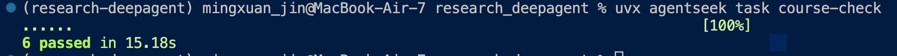
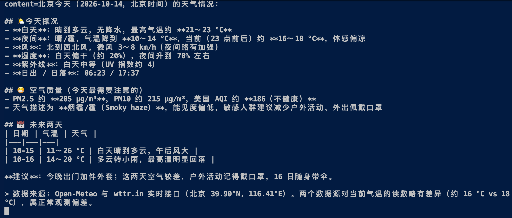
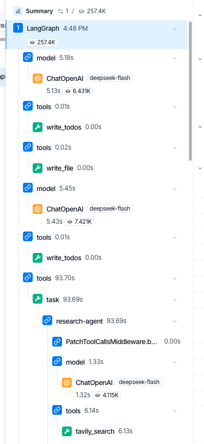

# 打卡内容

给教程设计的建议：准备篇和第一二章的关系实在不大，特别是第二章，不知道课程里写的代码和agentseek给的模版有什么关系，也不知道要怎么改；准备篇的环境都设置好了，但是agentseek的模版是在另一个my_deepagent文件夹里，新手学得晕头转向有点混乱了

## Task1完成的内容：

用agentseek的default模版做了第一章和第二章的两个实验，学习了DeepAgents的基础知识

offline验证通过

Live验证：使用模型deepseek-flash

主要遇到的问题：

1. 硅基流动我在国外注册不了，教程里设置api的时候有很多需要修改的地方
2. 没懂课程里的实验和agentseek给的模版有什么关系...问AI问了好久才明白
3. 尝试做lecture2的实验的时候，agent一直不调用我写的get_weather，也没用internet_search,直接用了bash + curl

Live验证返回的结果：

LangSmith Trace：

# 笔记

声明：本笔记内容来源于对datawhialechina deep-agents-in-action项目第一章以及第二章内容的学习，相关著作权归作者本人

教程链接：https://datawhalechina.github.io/deepagents-in-action/chapters/ch01-agent-harness/；

## Chap.1 DeepAgents诞生逻辑

DeepAgents的出现是为了解决经典的“重复造轮子”问题，将常用的、经典的能力直接封装好，开箱即用。比如说一个AI编程助手中，文件读写工具、调度机制等等，这些都是Agent应用很常用到的

### Agent开发的三个层次

在 LangChain 的技术栈中，Agent 开发被划分为三个层次

|                        | eg          | 解决的问题                                             | 适用场景                         | 个人需求                                                     | 需要做的内容                                            |
| :--------------------: | ----------- | ------------------------------------------------------ | -------------------------------- | ------------------------------------------------------------ | ------------------------------------------------------- |
|   底层 Agent Runtime   | LangGraph   | Agent世界的操作系统，解决“Agent怎么可靠地运行”         | 最大灵活性，精细控制，复杂工作流 | 需要文件操作、上下文管理和子任务委派，让 Agent 自主完成多步骤任务 | 配置业务工具、提示词、后端和需要启用的能力              |
| 中间层 Agent Framework | LangChain   | 在runtime的基础上提供更高层次的开发体验，标准化易上手  | 快速开发，标准化应用             | 需要标准的模型—工具循环，希望自行决定上下文策略与中间件组合  | 组合工具与 Middleware，定制每轮模型和工具调用的行为     |
|   上层 Agent Harness   | Deep Agents | 工具箱，**预置了一整套经过验证的工具接口和中间件框架** | 复杂多步骤应用，自主性高         | 流程包含固定步骤、条件分支，或需要精确控制整体执行路径       | 定义节点、边与路由，把确定性步骤和 Agent 调用编排在一起 |

可以先从deep agents开始，等需求超过控制范围时再深入Langchain或者langgraph，也可以直接从langgraph开始，只是自己要定义更多执行结构

### Why Agent Harness

核心价值：把被验证过的、Agent面对复杂问题时需要的模式固化下来，让你不需要每次都从头实现

eg. **文件系统操作能力**：能读写、搜索、编辑文件; **任务规划能力**：能把大任务拆成小步骤;**子任务委派能力**：能把部分工作交给子 Agent; **上下文管理策略**：防止对话过长导致 LLM “失忆”

### 核心理念 

Context Engineering

改变传统的把所有信息都塞在一个prompt里，而是引入一个虚拟文件系统

- 需要读文件时，调用 `read_file` 按需读取
- 需要记录中间结果时，调用 `write_file` 写到文件里
- 需要搜索时，调用 `grep` 或 `glob` 查找
- 大文件只读取需要的部分（`offset` / `limit` 参数）

这个”文件系统”是**虚拟的、可插拔的**：

- 可以是内存中的临时存储（开发调试用）
- 可以是本地磁盘（处理真实文件）
- 可以是持久化数据库（跨会话保持记忆）
- 可以是远程沙箱（安全执行代码）
- 甚至可以混合使用（不同路径路由到不同后端）

> **“可插拔”**（Pluggable）是一个软件架构设计概念，意思是：**系统的各个底层实现可以像“U盘插拔”一样灵活替换，而不需要修改上层业务代码**
>
> 软件系统对外只暴露一套**标准的文件操作接口**（比如：读取文件 `read`、写入文件 `write`、删除文件 `delete` 等），不管底层适用什么存数据的，上层的代码调用的都是用相同的命令；随时可以拔掉当前的实现，换成另一个
>
> eg. 你在开发阶段可能用的是**内存存储**（速度快，关掉就没了）；等项目上线部署时，只需要改一行配置，就能直接换成**本地磁盘**或**持久化数据库**。此时，你的业务代码一行都不用改

> [!NOTE]
>
> DeepAgents和LangChain/LangGraph在上下文管理方式上的区别：前者内置中间件：**文件系统卸载 + 自动摘要 + 子代理隔离**；后者需要开发者自定义State和Checkpoint逻辑

### 竞品对比

**Deep Agents 的独有优势：**

- **模型灵活性**：随时切换模型提供商，不锁定任何厂商。这对企业级应用至关重要
- **长期记忆（Long-term Memory）**：通过 Memory Store 实现跨会话、跨线程的持久化记忆。Claude Agent SDK 和 Codex SDK 都不支持这一特性
- **虚拟文件系统 + 可插拔后端**：将文件操作抽象为统一接口，后端可以是内存、磁盘、数据库或沙箱
- **沙箱作为执行后端**：Agent 的调度循环与执行环境可以分离，将文件或代码操作交给远程沙箱；Deep Agents 通过 Backend 接入这类架构
- **生产部署**：通过 LangGraph Platform 部署，配合 LangSmith 实现完整的可观测性

**Claude Agent SDK 的独有优势：**

- 与 Claude 模型的深度集成
- Hooks 系统，便于拦截和控制 Agent 行为
- 支持自定义 HTTP/WebSocket 层和容器化部署

**Codex SDK 的独有优势：**

- OS 级别的沙箱模式（`read-only`、`workspace-write`、`danger-full-access`）
- 内置 MCP Server 模式

> ⭐️ SDK是什么？
>
> Software Development Kit, Harness对外提供的开发工具箱，一套编程接口+工具+文档的打包

### 技术全景

图源：https://datawhalechina.github.io/deepagents-in-action/chapters/ch01-agent-harness/

| 能力分组   | 关键组件与职责                                               | 后续章节                                                     |
| ---------- | ------------------------------------------------------------ | ------------------------------------------------------------ |
| 执行环境   | `FilesystemMiddleware` 提供文件工具，Backend 决定文件存到哪里；沙箱后端支持 Shell 执行，Interpreter 提供代码编排；自定义工具和 MCP 接入业务系统 | [文件系统](https://datawhalechina.github.io/deepagents-in-action/chapters/ch03-virtual-filesystem/) · [沙箱](https://datawhalechina.github.io/deepagents-in-action/chapters/ch10-sandboxes/) · [MCP](https://datawhalechina.github.io/deepagents-in-action/chapters/ch12-mcp/) · [Interpreter](https://datawhalechina.github.io/deepagents-in-action/chapters/ch15-interpreters/) |
| 上下文管理 | 摘要中间件缩短模型输入并保存可回查的历史；大结果卸载到文件；`SkillsMiddleware` 提供技能元数据与读取指引，正文由模型按需调用 `read_file` 获取；`MemoryMiddleware` 加载指定的记忆文件；持久化 Backend 保存可跨对话使用的信息 | [上下文与 Backend](https://datawhalechina.github.io/deepagents-in-action/chapters/ch03-virtual-filesystem/) · [Skills](https://datawhalechina.github.io/deepagents-in-action/chapters/ch07-skills/) · [记忆](https://datawhalechina.github.io/deepagents-in-action/chapters/ch08-long-term-memory/) |
| 任务委派   | `SubAgentMiddleware` 提供 `task`，让子 Agent 用独立上下文处理任务并返回结果；`TodoListMiddleware` 提供显式计划与进度状态 | [任务规划](https://datawhalechina.github.io/deepagents-in-action/chapters/ch04-task-planning/) · [子 Agent](https://datawhalechina.github.io/deepagents-in-action/chapters/ch05-subagents/) · [异步子 Agent](https://datawhalechina.github.io/deepagents-in-action/chapters/ch06-async-subagents/) · [动态子 Agent](https://datawhalechina.github.io/deepagents-in-action/chapters/ch16-dynamic-subagents/) |
| 人机控制   | `HumanInTheLoopMiddleware` 在指定工具调用前暂停；文件权限规则限制具体路径的操作，也可以触发人工审批 | [人机协作](https://datawhalechina.github.io/deepagents-in-action/chapters/ch09-human-in-the-loop/) · [文件权限](https://datawhalechina.github.io/deepagents-in-action/chapters/ch11-filesystem-permissions/) |

**Tool 是模型可以请求的动作；Middleware 提供能力并控制执行环节；Backend 实现文件操作和存储**

## Chap.2 快速上手

本章笔记都写在了对应的代码中
